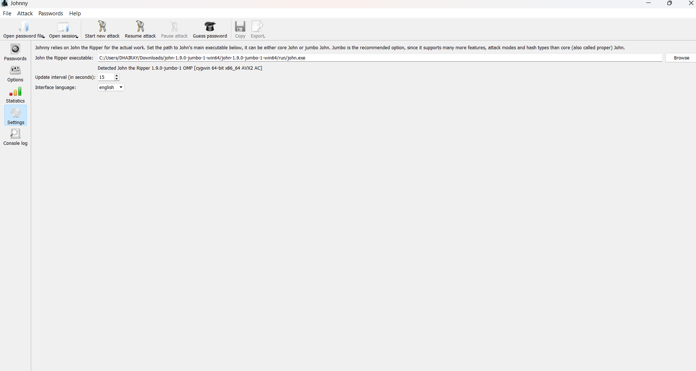
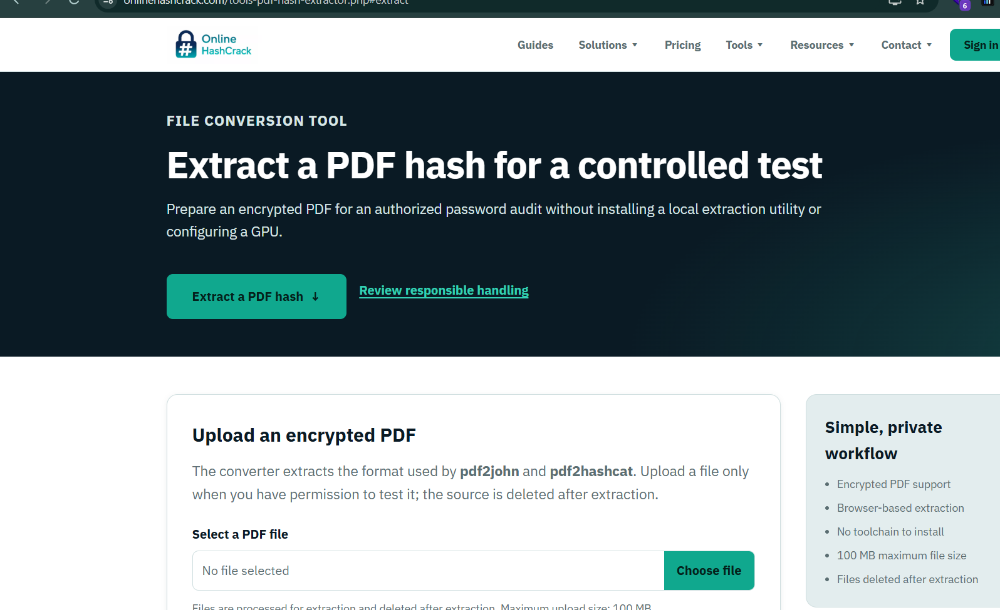
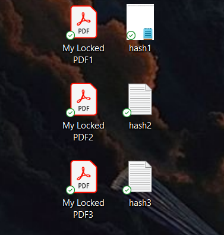
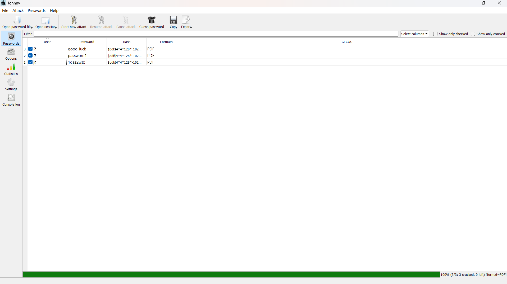
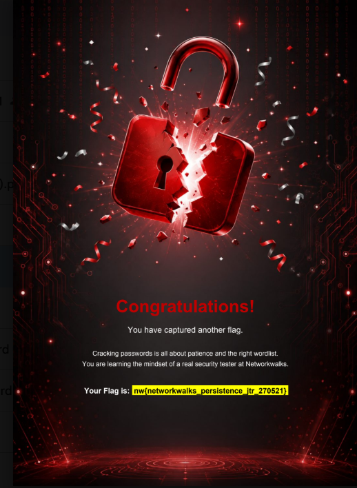
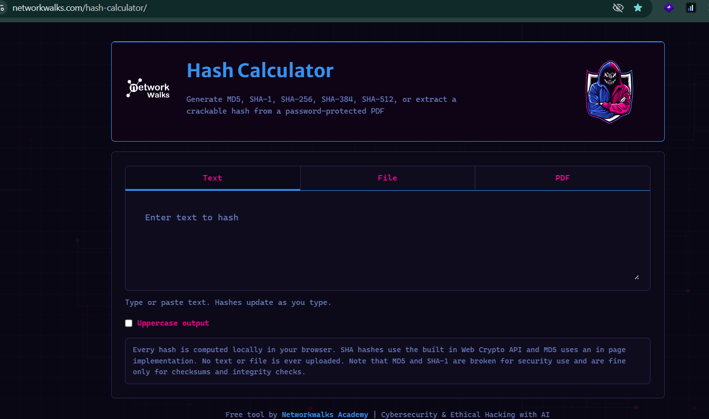
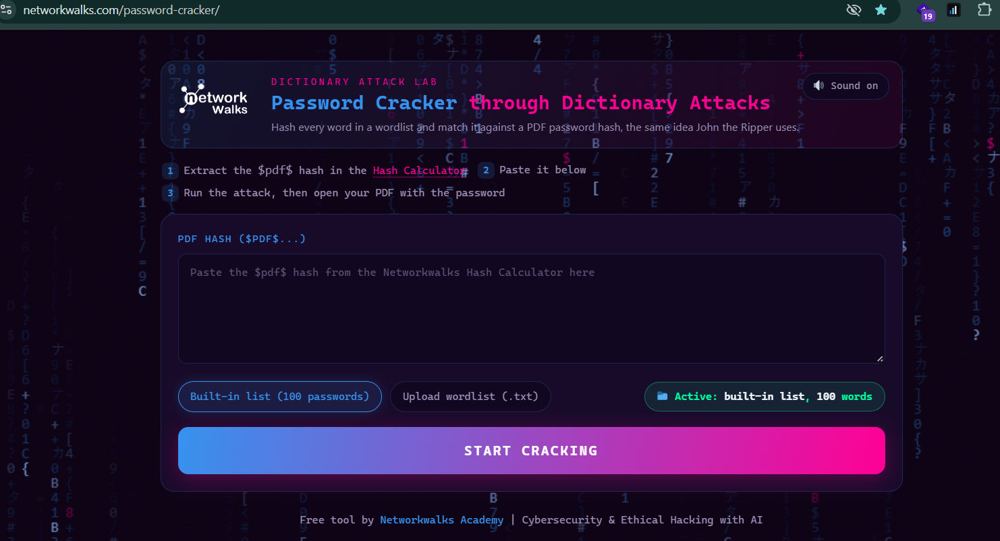
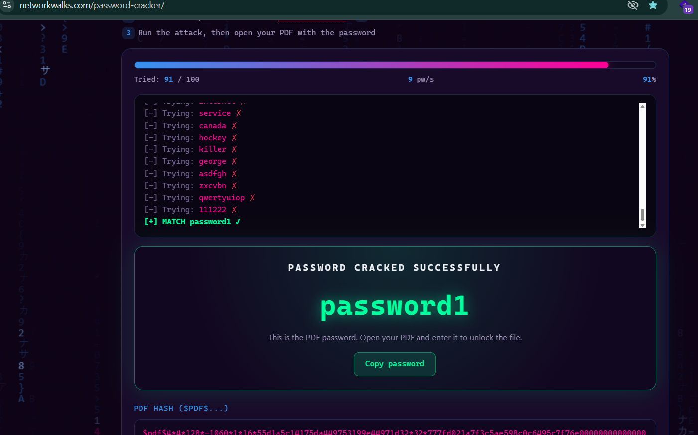
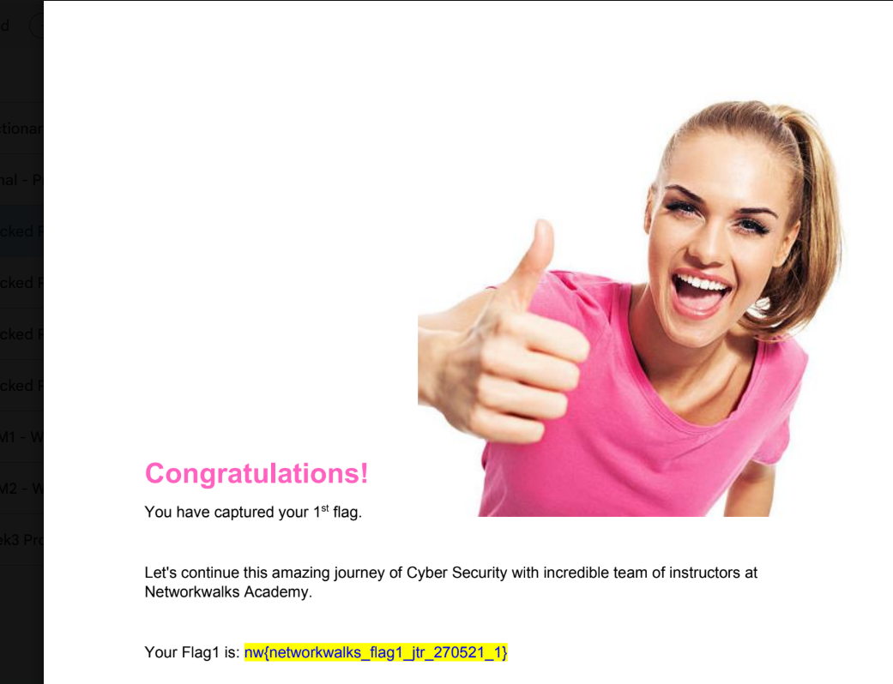

# 🔐 Week 3: Password Security Assessment and Cracking

**Networkwalks Cybersecurity Internship — Week 3**

This repository documents the practical activities completed during Week 3 of the Networkwalks Cybersecurity Internship, focusing on offline password cracking with John the Ripper (JTR) and web-based hash calculation and cracking.

## Completed Modules

- **W3-PM1:** Password Cracking with John the Ripper (JTR)
- **W3-PM2:** Hash Calculator & Web Password Cracker
- **W3-PM-FINAL:** Consolidated Practical Report

**Full Report:** [Week3-PM1-PM2-Report.pdf](Week3-PM1-PM2-Report.pdf)

---

## Disclaimer

All activities were performed using self-generated, authorized test data and an educational lab environment for learning purposes.

No unauthorized access, exploitation, or testing against real third-party accounts was performed.

## Tools and Technologies

| Tool                    | Purpose                                       |
| ----------------------- | --------------------------------------------- |
| Kali Linux (VirtualBox) | Practical environment                         |
| John the Ripper (Johnny)| Offline dictionary-based password cracking    |
| pdf2john / Hash Extractor| Extracting password hashes from locked PDFs  |
| Hash Calculator         | Generating cryptographic hashes (MD5/SHA)     |
| Web Password Cracker    | Online dictionary-based hash cracking         |

---

## W3-PM1: Password Cracking with John the Ripper (JTR)

**Environment:** Kali Linux in VirtualBox

**Target:** 3 password-protected test PDF files

**Methodology:** Hash extraction followed by offline dictionary attack using Johnny GUI.

### Activities Performed

1. Launched John the Ripper (Johnny GUI) on Kali Linux.
2. Used the PDF Hash Extractor tool to extract hashes from 3 locked test PDFs.
3. Loaded the extracted hash files into Johnny.
4. Executed dictionary-based cracking using a wordlist.
5. Recovered all 3 plaintext passwords and captured the respective flags.

### Cracked Results

| Target File | Recovered Password | Status  |
| ----------- | ------------------ | ------- |
| Test PDF 1  | `good-luck`        | Cracked |
| Test PDF 2  | `password1`        | Cracked |
| Test PDF 3  | `1qaz2wsx`         | Cracked |

### Screenshots

**1. Johnny GUI Setup**

**2. PDF Hash Extractor Tool**

**3. Locked PDFs and Hash Files**

**4. Johnny Cracked Passwords List**

**5. Flag 1 Captured**

**6. Flag 2 (Persistence) Captured**

**7. Flag 3 Captured**

---

## W3-PM2: Hash Calculator & Web Password Cracker

**Methodology:** Cryptographic hash generation and online dictionary lookup.

### Activities Performed

1. Opened the Hash Calculator utility to generate cryptographic hashes.
2. Input the generated hash into the Web Password Cracker tool.
3. Executed an automated dictionary check (matched in 91/100 attempts).
4. Verified the recovered password (`password1`) and captured the final flag.

### Screenshots

**1. Hash Calculator Tool**

**2. Password Cracker Tool**

**3. Password Cracked Result**

**4. Flag 4 Captured**

---

## Key Takeaways

- Common and predictable passwords (`password1`, `1qaz2wsx`, `good-luck`) can be cracked within seconds using dictionary attacks.
- Password-protected documents rely heavily on password complexity; weak passwords completely undermine encryption.
- John the Ripper and its GUI wrapper (Johnny) automate hash format detection and wordlist attacks efficiently.
- Strong passwords require sufficient length, randomness, and mixed character sets to resist offline cracking.

## Conclusion

During Week 3, I gained practical experience with password security assessments, PDF hash extraction, and dictionary-based cracking using John the Ripper on Kali Linux as well as web-based hash tools.

These activities strengthened my understanding of cryptographic hashing, password vulnerabilities, and defensive password policies.

---

## Author

Dhairay Kanojiia

**Cybersecurity Internship** -- **Week 3 Practical Submission — November 2026**
